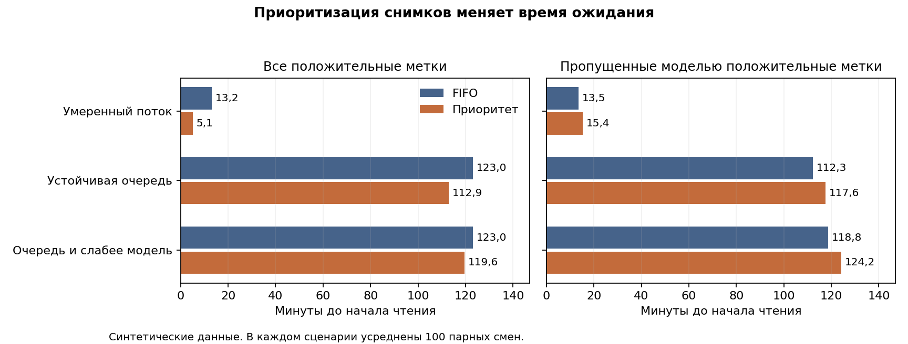

# Скрининг туберкулёза и очередь на чтение снимков

**Площадка для проверки.** Городская поликлиника №15 акимата города Астаны

**Тема проекта.** Приоритизация рентгенограмм грудной клетки в очереди на врачебное чтение при скрининге туберкулёза  
**Автор.** Togzhan Serik, Astana IT University

## Почему эта задача актуальна

В июне 2026 года Минздрав РК сообщил о кадровом дефиците и отдельно отметил, что в ряде регионов он продолжает расти. Публикация описывает врачебные кадры в целом [1]. ВОЗ публикует оценку заболеваемости туберкулёзом по Казахстану [2]. В заявлении ВОЗ 2025 года шесть конкретных CAD-продуктов соответствовали критериям эффективности для скрининга туберкулёза по рентгенограммам у людей от 15 лет [3]. Это основание изучить очередь на чтение снимков. В официальном справочнике Управления общественного здравоохранения Астаны поликлиника №15 указана по адресу проспект Р. Кошкарбаева, 64 [6]. Поликлиника выбрана как площадка для проверки в Астане. Тип оборудования для скрининга, фактический поток исследований, время ожидания и доступность врача предстоит уточнить у учреждения. О распространённости этих проблем в других регионах можно судить после отдельных замеров. КТ, МРТ и цифровая флюорография требуют своих наборов данных и проверки.

## Вопрос исследования

Можно ли быстрее передавать снимки с признаками туберкулёза на врачебное чтение и насколько при этом увеличивается ожидание для снимков, которые алгоритм ошибочно оставил без приоритета?

## Метод

**Анализ изображений.** Прозрачная базовая модель в Python уменьшает PNG до 48×48 пикселей и обучает логистическую регрессию на яркостях. По Shenzhen выделяются обучающая и валидационная части. На валидации выбирается максимальный порог, отмечающий не менее 90% положительных примеров. Этот порог фиксируется перед проверкой на Montgomery. Метрики: ROC AUC, Average Precision, чувствительность, специфичность и матрица ошибок. Метки NLM описывают нормальные снимки и снимки с признаками, совместимыми с ТБ. Это учебный эксперимент со сменой учреждения и аппаратов. Влияние низкого разрешения и возможных визуальных подсказок от аппаратов требует отдельной проверки [4, 5].

**Очередь.** Сравниваются чтение в порядке поступления (FIFO) и приоритет снимков с отметкой. Когда самый старый ожидающий снимок уже ждёт 60 минут, он берётся следующим. Правило приостанавливает приоритет и может допускать ожидание дольше 60 минут при перегрузке. Все снимки читаются одним условным врачом. Поступления моделируются в течение условных 8 часов, чтение продолжается до окончания очереди. На снимок требуется 4–8 минут. Доля положительных меток задана как 5%. В двух сценариях используются 90% чувствительности и 80% специфичности. В третьем обе характеристики равны 65%. Эти числа заданы для эксперимента.

## Проверка на открытых снимках

В пилот случайно отобраны по 20 снимков каждого класса из каждого набора NLM. Shenzhen разделён на 30 обучающих и 10 валидационных снимков. Все 40 отобранных снимков Montgomery использованы только для внешнего теста. Список файлов и результаты находятся в results/public_pilot. На тесте ROC AUC составил 0,63, Average Precision — 0,625. Порог пометил все 40 снимков: 20 верных отметок и 20 ложных. Чувствительность составила 100%, специфичность — 0%. При таком пороге отметка бесполезна для приоритизации. Малый валидационный набор делает порог нестабильным, а искусственно сбалансированный тест не отражает состав реальной очереди. Результат относится к этой выборке. Следующая проверка должна использовать полные когорты и больше снимков для подбора порога. Параметры симуляции заданы независимо от этого пилота.

## Результаты симуляции

Каждая строка усредняет по 100 парных сменам. Смены без случаев соответствующей подгруппы исключаются из расчёта среднего для этой подгруппы. Значения выражены в минутах ожидания **до начала чтения**.

| Сценарий | Положительные, FIFO → приоритет | Ложноотрицательные, FIFO → приоритет | P90 всех снимков, FIFO → приоритет |
|---|---:|---:|---:|
| Умеренный поток | 13,15 → 5,09 | 13,50 → 15,36 | 25,78 → 29,30 |
| Устойчивая очередь | 123,05 → 112,92 | 112,27 → 117,63 | 220,81 → 220,81 |
| Очередь и менее точная модель | 123,05 → 119,62 | 118,78 → 124,24 | 220,81 → 220,81 |

В умеренном сценарии положительные случаи начинали читать в среднем на 8,06 минуты раньше. Снимки с пропущенной положительной меткой при этом ждали на 1,86 минуты дольше. В сценарии перегрузки суммарное время чтения в обоих режимах составило 720,88 минуты на смену с учётом обработки оставшейся очереди. Приоритизация меняет, кто ждёт, а модель экономии рабочего времени потребовала бы отдельного эксперимента.

## Что запросить у поликлиники №15

- Как плотно загружен кабинет и где описывают снимки, если они сделаны на месте. Уточнить вид исследования, тип оборудования, график чтения и действующий порядок срочности.
- Обезличенные агрегаты за 2–4 недели с количеством исследований по сменам и временем от получения снимка до начала чтения либо заключения. Для двух временных метрик нужны отдельные поля.
- При наличии разрешённого исследовательского доступа — выгрузку для локальной ретроспективной проверки с независимой итоговой меткой, возможностью учесть повторные снимки одного пациента и разделением по учреждениям. Для начала достаточно агрегатов. Идентифицирующие данные для работы над проектом не нужны.

Шаблон сводной таблицы находится в local_shift_template.csv. Одна строка — одна смена и один вид исследования. Если время начала чтения не фиксируется, поле для него оставляют пустым. Количество поступивших и описанных снимков за смену учитывают отдельно. Для настройки симуляции длительность чтения и ожидание до него измеряют по разным событиям.

Нужно сравнить прототип с фактическим порядком чтения, включая уже существующие правила срочности, и проверить результаты по типу аппарата и учреждению. Исходы пилота оцениваются по времени до чтения, доле пропусков, числу лишних отметок и времени чтения. Решение об обследовании и интерпретации остаётся у клинической команды.

## Источники

1. [Минздрав РК. Актуализация данных по кадровому обеспечению, июнь 2026](https://www.gov.kz/org/dsm/press/news/details/1242801?lang=ru)
2. [ВОЗ. Профиль Казахстана и показатель заболеваемости туберкулёзом](https://data.who.int/countries/398)
3. [ВОЗ. Use of computer-aided detection software for tuberculosis screening, 2025](https://www.who.int/publications/i/item/9789240110373)
4. [Jaeger et al. Two public chest X-ray datasets for computer-aided screening of pulmonary diseases](https://pubmed.ncbi.nlm.nih.gov/25525580/)
5. [NLM. Montgomery County и Shenzhen Hospital, открытые наборы изображений](https://data.lhncbc.nlm.nih.gov/public/Tuberculosis-Chest-X-ray-Datasets/index.html)

6. [Управление общественного здравоохранения Астаны. Справочник медицинских организаций](https://www.gov.kz/org/astana-uoz/documents/details/628239?lang=ru)
